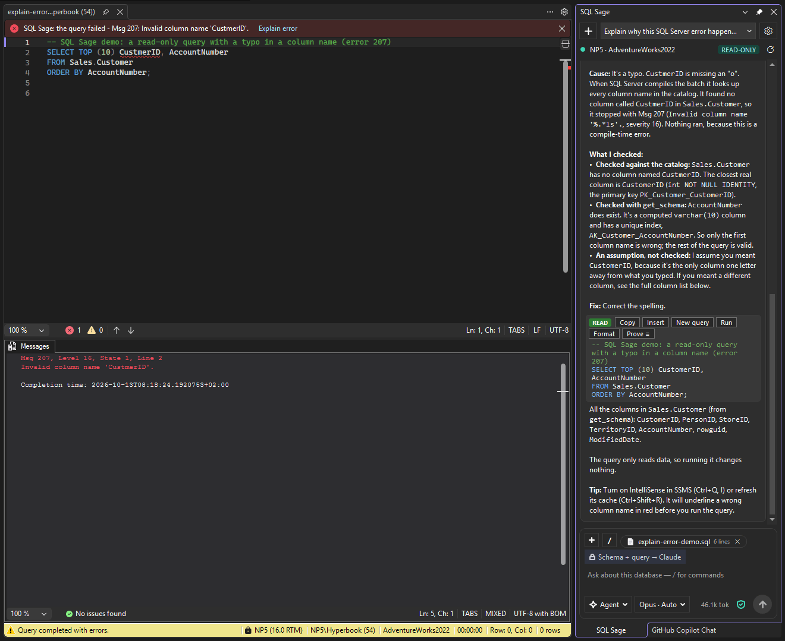

# SQL Sage

**AI pair-DBA for SSMS 22 that proves & logs what it changes — running on your own Claude / ChatGPT / Codex account, no API key needed with Claude Code or Codex sign-in.**

SQL Sage is an English-language extension you install inside **SQL Server Management Studio 22** on Windows (a VSIX add-in). It brings an AI pair-DBA into the query editor: it explains errors, tunes slow T-SQL, and runs SQL safely — signed in with your own **Claude** (Claude Code) or **ChatGPT / OpenAI Codex** account, so there is **no API key** and no second, metered AI bill. It runs as part of SSMS on your machine; it is **not** a web app or an online SQL editor.

It is an independent extension built by **Luma (LUMA sp. z o.o.)** and is **not affiliated with Microsoft, Anthropic or OpenAI**.

## Why it's different — Copilot guesses, SQL Sage proves it

Most AI in SSMS predicts an answer from the model. SQL Sage reads the actual server through DMVs and system catalogs, then **proves and logs** what it did. Four deterministic surfaces make it a real SQL Server AI assistant rather than a chat box:

- **Change-Impact** — before any `ALTER` / `DROP`, see exactly what breaks: dependent views, stored procedures and triggers, inbound foreign keys, and the rows at risk. The blast radius, computed — not guessed.
- **Incident Mode** — one-click live triage of a struggling server: the blocking chain (including the most common real culprit — an idle session that left a transaction open), top waits, and the most expensive queries, with **every claim cited to a real number** from a DMV. If your login can't see other sessions, it says so instead of reporting "no blocking".
- **Prove-It** — proves that an AI rewrite of a query returns the **same rows** as the original, using a deterministic multiset fingerprint. Zero AI tokens spent — it's pure computation, not a second opinion from the model.
- **Tamper-evident audit log** — a local, hash-chained record of what SQL Sage ran or blocked, with an evidence export for a reviewer or change ticket. Passwords and other secret values are replaced with `?` before an entry is written (from 0.35.4). Tamper-evident, not tamper-proof: it shows edits inside a day's file, not a rebuilt or deleted file.

## Bring your own AI account

SQL Sage does not resell tokens and never sees your AI bill. Sign in with an account you already have:

- **Claude in SSMS** via the Claude Code CLI, or
- **ChatGPT / OpenAI Codex in SSMS** via the Codex CLI.

Pick the provider and model in the panel. With Claude Code or Codex sign-in there is no API key to paste (an Anthropic API key is optional), and no per-token charge from us. AI usage itself comes from your own Claude or ChatGPT plan.

New models appear on their own: the model list is read live from your Claude Code installation, so a new Claude model shows up without waiting for a SQL Sage release. You also choose **how hard the AI thinks** — the model button at the bottom of the chat (for example `Opus · Auto`) offers exactly the effort levels your model supports (for example Low → High → Max), and `/effort high` raises it for a single answer. "Auto" keeps the fast default; higher effort is slower and uses more of your plan's limits.

Two modes, picked next to the model:

- **Agent** (default) — the AI may run read-only queries and SQL Sage's tools to check its answer; writes always ask you first.
- **Ask** — the AI answers only from the query you attached and the chat, and **runs nothing on the server**: that turn has no tools at all. Available with Claude Code and your own Anthropic API key; not with Codex, which always loads your own MCP servers, so SQL Sage can't guarantee a tool-free turn there.

A chip above the message box always shows what leaves your computer in that turn (for example `Schema + query → Claude`), and the privacy switches sit behind a shield next to the round Send button, which turns into Stop while the answer streams. The panel follows every SSMS 22 theme, light and dark.

## Safe by default

A ScriptDom gate classifies every statement before it runs:

- **`SELECT` runs automatically** so exploration stays fast.
- **DML / DDL stops for explicit confirmation**, with the exact SQL shown in front of you before anything executes.
- Queries that reach **beyond the current database** — linked servers, `OPENQUERY`, `OPENROWSET` (including `BULK` file reads), `OPENDATASOURCE` — always stop for confirmation, even when they look like a plain `SELECT`.
- SQL Sage reads **schema and DMVs**; it **never sends your query results to the model** without an explicit per-session opt-in — and results you shared with one AI provider are **not re-sent to another** if you switch, unless you agree again.
- **Run** executes only in the new query window SQL Sage opened, after checking the SQL, server and database match; every step (approved → dispatched → done or failed) lands in the audit log.
- **Mask names** replaces server, database, login, host and file names with placeholders (`<database2>`, `<login1>`, …) in everything sent to the AI — tool results, the conversation and your own system prompt — stable for the whole chat. From version 0.35.1 inline completions are masked too: the text around the cursor goes with placeholders, the suggestion gets the real names back on your machine, and nothing is sent when SQL Sage cannot read the server's names. Table and column names are not masked.
- Chat history is **encrypted on disk** (Windows DPAPI) with a retention setting, or you can turn saving off.
- The AI can use **only SQL Sage's tools**: Codex runs read-only without its own shell or web search, and Claude Code's own file, shell and web tools are blocked in every SQL Sage turn. An answer stops after 12 steps or 10 minutes and tells you so.
- Need help? **Copy diagnostics** builds a support report you preview first — no SQL, results, server/database names or keys.

## Editions & platforms

Edition-aware across **box SQL Server**, **Azure SQL Database**, and **Azure SQL Managed Instance** — it uses what each platform exposes and degrades gracefully where a feature doesn't exist (for example, features that depend on server-level DMVs unavailable on Azure SQL Database).

| | |
| --- | --- |
| Host | SQL Server Management Studio 22 |
| OS | Windows · x64 / Arm64 |
| Targets | SQL Server (box), Azure SQL Database, Azure SQL Managed Instance |
| AI providers | Your own Claude (Claude Code) or ChatGPT / OpenAI Codex (Codex CLI) |

## Install

1. Download the signed installer from the [**latest release**](https://github.com/LUMASoftPL/sqlsage/releases/latest) (currently **0.35.4**) or from **[sqlsage.lumasoft.org](https://sqlsage.lumasoft.org/?src=github)**.
2. Run it. **SSMS 22 is required.** When upgrading, close SSMS first.
3. Open SSMS, connect to a server, and open the SQL Sage panel. **Getting started** walks you through three steps — check the database (free, no AI), connect an AI (SQL Sage detects Claude Code, the Codex CLI or an API key and copies the install command), first answer. The plan pill in the chat header shows your trial or license and its dates.

The installer is Authenticode-signed by **LUMA sp. z o.o.** (Certum) — since 0.21.0 end to end, including the setup stage it extracts to `%TEMP%` and the uninstaller, so it also runs on PCs with Smart App Control or App Control for Business. Because this is a newer publisher whose download reputation is still building, Windows SmartScreen may show **"Windows protected your PC"** — choose **More info → Run anyway**. For extra assurance, verify the **SHA-256** hash published on the website and in the release notes against your downloaded file before installing.

## Pricing

- **30-day free trial** — all features, **no credit card**. The 30 days start with your first AI answer (or 14 days after you first open the panel, whichever comes first), so exploring the free tools first doesn't use up the trial.
- After the trial, SQL Sage keeps working as **SQL Sage Free** (below); AI features and the Proven & Accountable layer need a paid license. You bring your own AI account, so there is no metered AI charge from us on top.
- Current pricing (see the site for details): own it once from **$39**, or subscribe from **$29/year**.

Full, up-to-date pricing: **[sqlsage.lumasoft.org](https://sqlsage.lumasoft.org/?src=github)**

### Free after the trial

Every install starts with a 30-day free trial of everything. After it, SQL Sage keeps working as
**SQL Sage Free** — the editor tools below, with zero AI (LLM) calls. AI features and the Proven &
Accountable layer need a license.

- **Free:** **related tables after JOIN** — a list with the full `ON` clause and an alias, from foreign keys and,
  on databases without them, from matching key column names (always marked as a name match) and from joins you ran
  before (SQL Sage History, on this computer only); when it is safe, the table in FROM gets a short alias too
  (`Registration r`) — announced before you press Tab, one Ctrl+Z undoes it; right after `FROM <table>` and a space it can
  also suggest that alias in grey text (Tab accepts) — it steps aside for the IntelliSense list and while GitHub
  Copilot's completions are active, and stays off where SQL Prompt or SQL Complete is installed;
  **SQL Sage Search** (Ctrl+Alt+D) — find tables, views, procedures, functions and columns by name, and text inside
  definitions, across all databases on the server (unreadable databases are listed, never skipped silently) — and, on any
  column, **who writes and who reads it** (procedures, functions, views, triggers, as SQL Server records them; each row says how
  sure it is, and an empty answer says what was not checked instead of claiming nothing writes the column);
  **What's blocking now** — a live view in SQL Sage History of who blocks whom, including an idle session that left a
  transaction open, open transactions and which session is probably yours; KILL and GRANT only as scripts in a new
  window (F5 asks before a KILL runs);
  F5 execution warnings, Format SQL (uses SSMS's own
  formatter when available), Expand `SELECT *`, Qualify object names, Execute current statement,
  **Check this database** (Tools › SQL Sage Tools — read-only, no AI, and it shows what changed since your last check:
  new, resolved and unchanged findings), and the proven part of **Explain error** — when a query
  fails, SQL Sage shows what the catalog proves (the missing column and the closest real name, the foreign key
  or CHECK behind a 547, the key columns behind a duplicate, the column size behind a truncation, the parser
  position of a syntax error). Values from your rows are never shown or sent.
  Classic shortcuts (Ctrl+B, Ctrl+W · Ctrl+B, Ctrl+Q · Ctrl+K, Ctrl+Y · Shift+F5) step aside
  automatically when another SSMS add-in already uses them.
  **SQL Sage History** — every query you run in SSMS, kept on this computer only and encrypted for your
  Windows account: server, database, status (with the SQL Server error number of a failed run), duration,
  rows returned and READ/WRITE/DDL class, newest first, searchable. **Recently closed (unsaved)** keeps
  query tabs you closed without saving, so a lost script can be reopened. Only passwords and other secrets
  (for example in `CREATE LOGIN`) are replaced with `?` before saving — the rest is kept as typed — and query
  results are never stored; "Open in new window"
  reconnects to the same server and never runs anything. Retention 30 days by default; pause or switch off
  any time.
- **With a license:** AI chat, the AI explanation and fix for a failed query, Explain / Fix / Optimize / Document, AI completions (Alt+.), the
  Proven & Accountable layer — Change-Impact, Incident Mode, Prove-It — and, on any history entry, "Why is this
  slower than last time?" and a proof that the editor's version returns the same rows; plus the **"Is this slower than
  before?" card** — the History entry linked to Query Store, plans and run times compared, and a verdict worked out by code
  (no AI), each number with the exact T-SQL behind it and a Markdown note for the ticket.

Questions about Free: [GitHub Discussions](https://github.com/LUMASoftPL/sqlsage/discussions) (community, no SLA).

## Links

- **Website:** [sqlsage.lumasoft.org](https://sqlsage.lumasoft.org/?src=github)
- **Latest release:** https://github.com/LUMASoftPL/sqlsage/releases/latest
- **Discussions (Q&A):** https://github.com/LUMASoftPL/sqlsage/discussions
- **Issues & feature requests:** https://github.com/LUMASoftPL/sqlsage/issues
- **Email:** support@lumasoft.pl

---

SQL Sage is **commercial / proprietary software** — © LUMA sp. z o.o. This repository hosts releases, documentation and issue tracking; the product source is not open-source. Not affiliated with Microsoft, Anthropic or OpenAI.
